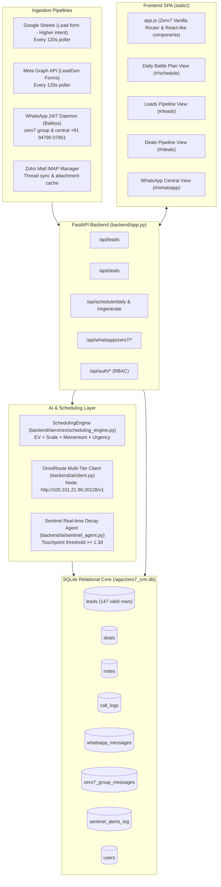

# COS Theta System Architecture & Data Model
**Workspace**: `COS Theta` (zero7.space)  
**Standard**: Institutional IPO-Grade Engineering & Operational Rigor

---

## 1. System Topology

---

## 2. Core SQLite Database Schema (`zero7_crm.db`)

| Table Name | Primary Purpose | Key Fields |
| :--- | :--- | :--- |
| `leads` | Inbound & prospect records | `id`, `name`, `business_name`, `phone`, `email`, `city`, `priority`, `call_stage`, `channel_data` (JSON), `created_at` |
| `deals` | Commercial closing pipeline | `id`, `lead_id`, `name`, `value`, `stage`, `expected_close_date`, `assigned_to` |
| `notes` | Human team remarks & updates | `id`, `lead_id`, `user_id`, `content`, `created_at` |
| `call_logs` | Phone call recordings & transcripts | `id`, `lead_id`, `caller_phone`, `duration`, `recording_url`, `transcript`, `created_at` |
| `whatsapp_messages` | 1-to-1 customer WhatsApp history | `id`, `lead_id`, `lead_phone`, `account_phone`, `message_text`, `direction`, `timestamp` |
| `zero7_group_messages` | Internal team chat signals from "zero7" | `id`, `sender_name`, `sender_phone`, `message_text`, `timestamp`, `matched_lead_id` |
| `sentinel_alerts_log` | Lead decay & fatigue alerts | `id`, `lead_id`, `alert_type`, `hours_since_contact`, `status`, `created_at` |
| `users` | CRM users & executioners (RBAC) | `id`, `name`, `email`, `role` (admin/member), `password_hash` |

---

## 3. Data Flow & Synchronization Protocols

1. **Google Sheets Sync (`sync_sheet_priorities`)**:
   - Runs every 120s via `run_background_meta_and_sheet_sync()`.
   - Parses columns dynamically by header text matching (`full_name`, `phone_number`, `NEXT STEP`, `UPDATES`, etc.).
   - Normalizes phones to 10 digits for duplicate prevention.
   - Updates `channel_data` with rich JSON (`sheet_next_step`, `sheet_updates`, `form_answers`, `employee_count`).
   - Hard invariant: Rejects any row where `name` and `phone` are both empty.
2. **Scheduling Engine (`generate_daily_battle_plan`)**:
   - Computes Expected Value: $EV = \text{Scale Score} \times \text{Momentum Score} \times \text{Urgency Multiplier}$.
   - Exact 50-action budget: Slots 1–10 (Whales / late-stage closes), Slots 11–20 (Necessity commitments), Slots 21–35 (High-yield deals), Slots 36–50 (Squeeze queue).
   - Generates sharp 3–7 word actions in brand orange.
3. **Droplet Deployment**:
   - Production Host: `68.183.92.215` (DigitalOcean Droplet).
   - Container: `cos-theta`.
   - Deployment script: `python scratch/sync_to_droplet.py`.
