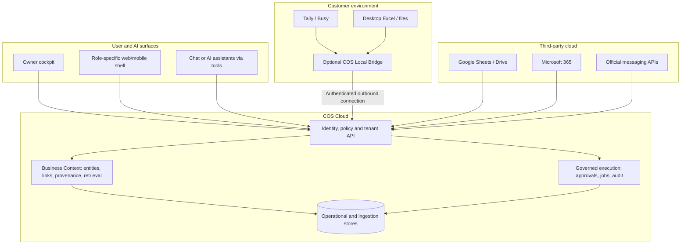

# COS Θ — Master Context, Founding Thesis, Product Strategy & Architecture

> **Zero7 / COS Theta | Portable context for Antigravity, coding agents, co-founders and future conversations**  
> **Version:** 1.0 — 13 October 2026  
> **Status:** Working strategic synthesis; **not** an approved engineering specification or a record of completed implementation.  
> **Sensitivity:** Internal working material. Review customer references and operational details before sharing externally.  
> **Source basis:** (1) Zero7's 12 October 2026 architectural manifesto, (2) subsequent founder–AI brainstorming and critique, and (3) explicitly linked third-party documentation.  
> **Reader instruction:** Preserve the founder's ambitious thesis, but distinguish aspirations, observed facts, proposals, and assumptions. Do not claim an implementation exists unless a repository, deployment, or customer has been inspected.

---

## Table of contents

1. [How to use this document](#1-how-to-use-this-document)
2. [One-page definitive context](#2-one-page-definitive-context)
3. [Origins: what Zero7 does today](#3-origins-what-zero7-does-today)
4. [The founder's changing mental model](#4-the-founders-changing-mental-model)
5. [COS Θ's actual product thesis](#5-cos-θs-actual-product-thesis)
6. [Strategic positioning: horizontal vision without aimless scope](#6-strategic-positioning-horizontal-vision-without-aimless-scope)
7. [Customer environments and reference use cases](#7-customer-environments-and-reference-use-cases)
8. [The desired end-user experience](#8-the-desired-end-user-experience)
9. [The proposed product system](#9-the-proposed-product-system)
10. [Technical architecture: control, data, execution and experience](#10-technical-architecture-control-data-execution-and-experience)
11. [Business context model and data architecture](#11-business-context-model-and-data-architecture)
12. [Integration architecture and connector priorities](#12-integration-architecture-and-connector-priorities)
13. [Deep dive: TallyPrime and on-premises Tally](#13-deep-dive-tallyprime-and-on-premises-tally)
14. [Deep dive: desktop Excel, Microsoft 365 and Google Sheets](#14-deep-dive-desktop-excel-microsoft-365-and-google-sheets)
15. [Deep dive: WhatsApp, email and other sources](#15-deep-dive-whatsapp-email-and-other-sources)
16. [Connector protocol, ingestion and reconciliation contracts](#16-connector-protocol-ingestion-and-reconciliation-contracts)
17. [The AI layer: interpretation, grounded answers and governed action](#17-the-ai-layer-interpretation-grounded-answers-and-governed-action)
18. [Dynamic micro-apps and the shell](#18-dynamic-micro-apps-and-the-shell)
19. [Security, privacy, reliability and operational safety](#19-security-privacy-reliability-and-operational-safety)
20. [Alternative architectures and why decisions remain open](#20-alternative-architectures-and-why-decisions-remain-open)
21. [Commercial model and escaping the consulting trap](#21-commercial-model-and-escaping-the-consulting-trap)
22. [Minimum viable product: what to build and what not to build](#22-minimum-viable-product-what-to-build-and-what-not-to-build)
23. [Concrete first customer pilot: consulting/audit LLP](#23-concrete-first-customer-pilot-consultingaudit-llp)
24. [Second-industry validation](#24-second-industry-validation)
25. [90-day execution plan and acceptance criteria](#25-90-day-execution-plan-and-acceptance-criteria)
26. [12–36 month capability roadmap](#26-1236-month-capability-roadmap)
27. [Success metrics and unit-economics framework](#27-success-metrics-and-unit-economics-framework)
28. [Risks, falsification tests and counterarguments](#28-risks-falsification-tests-and-counterarguments)
29. [Decision log: accepted direction, deferred choices, rejected claims](#29-decision-log-accepted-direction-deferred-choices-rejected-claims)
30. [Questions that have not been answered](#30-questions-that-have-not-been-answered)
31. [Recommended immediate engineering backlog](#31-recommended-immediate-engineering-backlog)
32. [Instructions for Antigravity and future AI agents](#32-instructions-for-antigravity-and-future-ai-agents)
33. [Suggested reusable prompts](#33-suggested-reusable-prompts)
34. [Glossary](#34-glossary)
35. [Sources and evidence register](#35-sources-and-evidence-register)

---

## 1. How to use this document

This file is intended to prevent context loss across different AI assistants, engineering conversations, and founder strategy sessions. Feed this complete file to an AI agent before asking it to plan a COS feature, make architectural decisions, or review an existing implementation. Use the shorter companion file, `COS_Theta_Quick_Context_for_AI_Agents.md`, when message context is limited.

### Evidence labels used throughout

- **[FOUNDER INTENT]**: An aspiration, principle, or preference directly expressed by the founder in conversation.
- **[ORIGINAL MANIFESTO]**: A claim or proposed implementation described in `New_Age_COS_Theta_Architectural_Synthesis.md` (12 October 2026). That document labels itself an approved blueprint, but independent implementation verification was not supplied here.
- **[REPORTED EXAMPLE]**: A customer, process, or operating practice described by the founder or original manifesto; not independently audited.
- **[RECOMMENDATION]**: A proposed direction, design, or priority from our collaborative analysis, subject to founder approval.
- **[HYPOTHESIS]**: A proposition needing customer, financial, or technical validation.
- **[VERIFIED EXTERNAL CAPABILITY]**: A specific integration capability supported by a linked vendor or project document, but not necessarily tested in a Zero7 environment.
- **[OPEN]**: Missing information or undecided architecture.

**Critical:** A recommendation is not automatically a founder decision; a documented vendor capability is not proof that the connector works in the target customer's environment. Never invent client contract values, implementation timelines, active deployments, account credentials, schema definitions, or test results.

---

## 2. One-page definitive context

**Company and mission.** Zero7 is pursuing an **AI-native technology/consulting model** and evaluating the creation of **COS Θ (Company Operating System Theta)**. The founder sees a future in which AI greatly lowers the cost of generating software, while businesses still need trusted data, access controls, integration, context, and dependable execution. The long-term goal is that **any business can use software designed around its own operations without repeatedly hiring developers to implement every change**. [FOUNDER INTENT]

**Current model.** Zero7 reportedly works closely with businesses in India, translating informal WhatsApp/voice feedback into quickly deployed, bespoke software through AI-assisted engineering. The original manifesto describes a WhatsApp → synchronization agent/Baileys → Antigravity → Git changes → client-specific prototype deployment loop. It names quarry, chemical trading, security/field service, and furniture implementations. These are useful reference cases but do not constitute verified revenue, retention, or product-market-fit metrics. [ORIGINAL MANIFESTO]

**Core difficulty.** Consulting produces revenue but requires substantial founder/engineering attention per customer. Independent repositories, applications and client-specific integrations risk multiplying support, regression testing, and maintenance work. The founder seeks **compounding reuse and business-owner self-service**, not simply faster agency delivery. [FOUNDER INTENT]

**Strategic insight.** The founder disputes the necessity of picking a single industry vertical: if AI makes application production much cheaper, domain-specific finished applications may become dynamically generated outputs, while the reusable product is the **trusted foundation for creating and operating them**. The recommended compromise is **horizontal core + focused initial job-to-be-done + cross-industry validation**, not a generic product attempting everything on day one. [FOUNDER INTENT + RECOMMENDATION]

**Current recommended product entry point.** Build a **Business Context & Execution Layer** that connects the software a business already uses, maps its people/projects/tasks/transactions/documents and provides a permission-aware owner/employee cockpit. Later enable governed actions and dynamically generated micro-apps. Proposed components: **COS Bridge** (connectors and local Windows agent), **COS Context** (provenance-aware business entity/relationship layer), **COS Cockpit** (role-based visibility and actions); later **COS Studio / dynamic shell**. [RECOMMENDATION]

**Why connectors first.** Many businesses use TallyPrime/Tally, desktop Excel, Google Sheets, Microsoft 365, WhatsApp, email and other legacy/on-prem tools. COS need not replace them initially. An on-prem **COS Local Bridge** can access authorized local services/files and establish an **outbound authenticated encrypted** connection to COS Cloud. Cloud connectors use OAuth, official APIs, delta/cursor tracking and webhooks where appropriate. [RECOMMENDATION]

**First pilot.** A newly discussed consulting/audit LLP tracks engagements, audit projects, multiple staff roles, handoffs, reviews and client communications in spreadsheets and other tools. The proposed pilot connects its tracker and one messaging/document source; gives partners a sourced view of at-risk engagements, responsibilities and pending follow-ups; and enables review/approval of communications. This should be a **paid, scoped, read-only-first** pilot, with data/security requirements and user validation. Customer identity, authorization, exact stack and commercial agreement remain unknown. [REPORTED EXAMPLE + RECOMMENDATION]

**Architectural principle.** AI interprets intent, retrieves context, drafts specifications, recommends actions and generates presentation; **deterministic, authorized services** validate and commit business-critical changes. Facts, inferences and proposed actions stay separate. A connected context graph is not a replacement for each application's authoritative system of record. [RECOMMENDATION]

**Immediate success test.** Can Zero7 connect a real LLP's spreadsheet and communication/document source, provide correct source-linked answers, and complete one approved follow-up workflow with less coordination? Then can the *same foundation* help a very different customer (quarry, security services, trading) with limited new core engineering? If yes, platform reuse is emerging. [HYPOTHESIS]

**Non-goals for first MVP.** Replace Tally; build a universal ERP; scrape all employees' private messages; unrestricted agent access to files/databases; arbitrary AI code execution in the main tenant process; perfect offline autonomy; direct-to-Wasm synthesis; zero infrastructure cost; full automatic generation of all enterprise software. [RECOMMENDATION]

---

## 3. Origins: what Zero7 does today

### 3.1 Founding operating insight

The original manifesto reports a very fast client feedback loop:

```text
Client talks via WhatsApp voice/text
  -> WhatsApp sync agent (originally Baileys)
  -> Antigravity AI coding workflow
  -> edits in a client-specific Git repository
  -> deploys to a client-specific prototype/application URL
  -> client gives more operational feedback
```

This supposedly lowers the time from customer request to working demonstration and supports highly bespoke enterprise workflows. **Treat as a reported workflow, not an audited productivity claim.** The existing production reality (repo counts, cloud providers, test coverage, customer billing and SLA) must be inspected before proposing migrations. [ORIGINAL MANIFESTO]

### 3.2 The specific scaling problem

The manifesto identifies four difficulties with one independent codebase or hosting stack per client:

1. Growing codebases make AI-assisted changes and regression control harder.
2. Features and defect fixes are duplicated between unrelated client implementations.
3. Infrastructure and operational maintenance may grow with each client.
4. Remote worksites and on-prem Windows software present connectivity/offline problems.

These are plausible risks, **not proof that a single multi-tenant runtime is the only solution**. Shared libraries, templates, managed deployment automation, independent instances with common source, pooled SaaS, and a hybrid architecture can also work. [ORIGINAL MANIFESTO + CRITICAL ANALYSIS]

### 3.3 What zero7's real bottleneck is likely to be

The primary target is not minimizing cloud-server count. It is reducing:

```text
Total cost per served customer =
  discovery + integration + implementation + testing +
  infrastructure + support + maintenance + risk/rework
```

A shared backend may reduce some costs but increase migration burden, correlated failure risk and cross-client regression exposure. The firm must measure the total cost and the fraction of changes needing Zero7 engineers. [RECOMMENDATION]

---

## 4. The founder's changing mental model

The progression of discussions matters because the newest framing refines rather than erases the original manifesto.

### Phase A — Bespoke agency improvement

Question: How can an AI-native consulting company deliver customized software with fewer people, faster iterations and better economics?

Initial answer: AI-assisted engineering, shared components, templates, recurring managed service revenue. Limitation: every new customer still depends on external engineering effort.

### Phase B — Universal business operating kernel

Question: Could one robust substrate safely execute many different business workflows while agents generate each business's custom logic and UI?

The manifesto proposes shared execution primitives, domain ontologies, declarative invariants/statecharts/decision tables, per-tenant hooks, PostgreSQL + optional offline SQLite, MCP tools and a customizable shell. It imagines a future of direct AI-to-bytecode execution. Useful as long-range research, but it treats broad architectural choices as inevitable before sufficient evidence. [ORIGINAL MANIFESTO]

### Phase C — Business-owner-created software

The founder clarified that the **business owner and employees understand business needs better than external programmers**. If agentic programming becomes cheaper, the owner should be able to state a requirement, validate it and have a micro-app or workflow created directly. No manual drag-and-drop workflow building should be a prerequisite. Low-code visual workflows may remain valuable as generated/explainable representations and runtime orchestration, not necessarily as the author's primary interface. [FOUNDER INTENT]

### Phase D — A contextual operating layer above existing software

A further refinement: Most customers already have some software. COS should **connect first rather than replace first**. Organize information across Tally, desktop Excel, Sheets, messages, email, files and projects into useful, provenance-aware business context. Offer the owner a first interface to the business; then coordinate actions; later generate missing software from that context. [FOUNDER INTENT]

### Phase E — Horizontal platform, cross-industry validation

The founder challenges traditional advice to start with one industry vertical. The current recommended position is to **specialize in a job/problem and core capability rather than a permanent industry vertical**. A consulting LLP can prove connected engagement coordination; a quarry or service company can test reuse of the same context, integration and execution foundation. [FOUNDER INTENT + RECOMMENDATION]

### The resulting synthesis

```text
Connect existing business software
    -> build trustworthy, permission-aware business context
    -> give users a unified role-specific command center
    -> coordinate and authorize cross-system actions
    -> generate missing micro-apps using existing context
    -> eventually support more business-led and agent-assisted evolution
```

The long-term aspiration is **a trusted operating intelligence layer that can create its own software when necessary**.

---

## 5. COS Θ's actual product thesis

### 5.1 North star

> **Make business software as adaptable as the business itself.**
>
> Any organization should be able to express how it operates and have that intent translated into connected, reliable, evolving software and workflows.

### 5.2 The more useful initial customer promise

> **Connect what your business already uses. Understand what's happening across those systems. Act from one place. Create the missing tools as your needs change.**

### 5.3 Four ideas that must not be conflated

1. **Context:** A trustworthy and current representation of people, entities, relationships, evidence, permissions and obligations.
2. **Execution:** Authorized actions against one or more systems with verifiable outcomes, idempotency and an audit record.
3. **Experience:** Role- and task-specific screens, chat surfaces and interfaces that adapt without becoming unpredictable.
4. **Creation:** Turning natural-language intent into versioned specifications, previews, tests and ultimately approved deployable micro-apps.

A demo of #4 does not prove #1 or #2. All four matter for the eventual platform.

### 5.4 Product differentiation hypothesis

The defensibility is **not** 'we generate React faster' or 'we offer chat with data'. It may arise from reliably maintaining business context and controlled operational execution across heterogeneous Indian SMB/mid-market stacks—including on-prem tools—while getting cheaper to implement for every additional customer. [HYPOTHESIS]

### 5.5 The founder's economic argument and its limits

The founder believes inexpensive AI-generated code erodes the historic advantage of selling one fixed vertical application to many customers. Instead, domain-specific software may be generated and customized per organization atop shared infrastructure. This is a **plausible forecast**, not a demonstrated law; domain expertise, integration depth, reliability, regulatory workflows and distribution can still support vertical vendors. Lower build cost does not eliminate maintenance and total ownership cost.

---

## 6. Strategic positioning: horizontal vision without aimless scope

**Decision frame:** Don't force Zero7 to become a quarry-only or audit-only software firm, but also don't take every conceivable application requirement into the platform MVP.

Different forms of focus:

| Focus type | COS approach |
|---|---|
| Industry vertical | Intentionally open; use multiple industries for tests |
| Initial customer problem | **Narrow**: fragmented operational context, follow-ups, coordination and cross-system visibility |
| Core technical capability | **Narrow**: read/connect/normalize/link/explain, then approved actions |
| Long-term platform ambition | **Broad**: adaptive business operating intelligence and app creation |
| Sales qualification | Businesses with a meaningful coordination problem, accessible systems, engaged sponsor and willingness to pay |

**Customer acceptance filter (proposed):** (a) a real owner/manager problem, (b) accessible authorized sources, (c) measurable time/risk reduction, (d) a manageable pilot scope, (e) a shared platform primitive being exercised or premium bespoke economics, and (f) a customer sponsor available for validation.

Avoid the false choice between 'one niche forever' and 'build every ERP module simultaneously'. The strategy is **horizontal core, use-case focus, cross-domain proof**.

---

## 7. Customer environments and reference use cases

All details below are **reported in the founding manifesto or conversation**; no independent verification of contract status, scale or deployment maturity has been performed. Names of individual contacts are intentionally omitted in this portable handoff unless operationally necessary.

| Environment | Reported operating context | Potential COS primitives |
|---|---|---|
| Stone crushing/quarry operator, Ambikapur | Multiple quarries; weighbridge tare/gross; dispatch slips (*parchi*); driver photos; Busy accounting on local PC; remote/offline conditions | Hardware/local bridge, entity/event provenance, dispatch status, offline strategy, accounting reconciliation |
| Chemical commodity trader, Mumbai | Broker market quotes and WhatsApp messages; price matrices; sales/credit terms; trading exposure | Ingestion, quotes, decision/approval rules, market data freshness, credit context |
| CCTV and biometric field-service company, Mumbai | Technicians, complaints, installation/service contracts and annual maintenance; skills-based routing; voice-friendly UX | Tasks, assignments, field service events, employee interface, attachment/evidence capture |
| Modular office furniture business, Bhiwandi | Catalogs, profile-cutting calculations, manufacturing/project stages | Project stage state, product/BOM semantics, domain-specific computation, approvals |
| **Consulting/audit LLP (new lead)** | Audits/engagements; sheets tracking projects, roles, progress; multi-step workflows; client/team messaging; owner needs stronger visibility | **Initial proposed pilot**: work tracker connector, engagements, tasks, responsible parties, deadlines, evidence and approved communication |

The first four examples were included in the manifesto as evidence of rapid custom delivery. The LLP was described later as a new business discussion; **do not assume it has signed a contract**.

### Cross-domain commonality to test

```text
An event or request
    -> source evidence
    -> identifies client/project/person/entity
    -> determines responsibility, status or next step
    -> applies permissions and validation
    -> proposes/executes an action
    -> records outcome and links it back to the source
```

The common *mechanism* may be reusable while domain semantics are not. Do not force weight slips, accounting vouchers and audit workpapers into one generic table merely because all have statuses.

---

## 8. The desired end-user experience

### 8.1 Owner/partner cockpit

An owner should be able to ask grounded questions such as:

- What is happening across my business right now?
- Which projects, invoices or dispatches require attention?
- Which clients have not sent required documents or payments?
- Which managers or teams are overloaded?
- What was promised in a conversation, and was it completed?
- What action should I consider next, and what evidence supports it?

The UI should show **source links, timestamps, freshness and uncertainty**, not polished but unverifiable summaries.

### 8.2 Managers and staff

The same business context should produce different experiences for a partner, audit manager, accountant, dispatch supervisor or field technician. They see only authorized data and tasks. A predictable default UI is important; fluidity should enable deliberate adaptation, not sudden autonomous layout changes.

### 8.3 Zero7's self-service goal

A customer says: 'Show today's pending approvals to managers, allow attachments, but hide financial margins.' COS should interpret the request, find relevant entities and actions, generate a structured micro-app specification, preview it, test permissions, and publish only after proper approval.

### 8.4 Surfaces

Initially use a responsive web cockpit; later support a native mobile shell where it is materially useful. Expose portable business actions through APIs/MCP to compatible assistants, with distinct presentation adapters for ChatGPT, web, WhatsApp, voice, etc. Cross-host UI portability should **not** be assumed universal.

---

## 9. The proposed product system

**Working names**, not yet a confirmed final brand architecture:

| Module | Responsibility | When |
|---|---|---|
| **COS Bridge** | On-prem bridge and cloud connectors to existing tools | MVP |
| **COS Context** | Structured, permission-aware business entities/relationships/provenance | MVP |
| **COS Cockpit** | Owner/team visibility, sourced insights, controlled actions | MVP |
| **COS Execute** | Durable business action requests, approvals, connectors, audit | MVP skeleton; expand after read-only pilot |
| **COS Studio** | Intent-to-specification, safe micro-app generation, versioning and publishing | Later |
| **COS Shell** | Common web/mobile UI component environment, role-based micro-app renderer | Lightweight early; expand later |

A customer without existing software may eventually create COS-owned records and micro-apps directly. A customer with Tally/Sheets/ERP should primarily use COS as a **unified interface above existing systems**, with clear authority boundaries.

---

## 10. Technical architecture: control, data, execution and experience

### 10.1 Reference design — conceptual, not a mandated stack



Separate four logical concerns even if they run in one codebase initially:

1. **Connect and ingest:** Receive only authorized source data, normalize it and monitor synchronization.
2. **Context and retrieval:** Resolve entities, relationships, provenance, access policy and uncertainty.
3. **Execution and controls:** Authorize action requests, run them with idempotency and reconcile results.
4. **Presentation and generation:** Render UI and allow AI to propose changes without bypassing the core controls.

### 10.2 Early stack (proposed; subject to inspection)

- Backend: FastAPI/Python or TypeScript/Node depending on current Zero7 code and staff expertise.
- Primary platform state: PostgreSQL with sound tenant isolation, migrations and backups.
- Jobs: durable worker/queue, retries, per-connector concurrency limits, idempotency and dead-letter visibility.
- Cloud connectors: official OAuth/APIs/webhooks, least-privilege scopes.
- Local connector: signed/distributed Windows agent or customer-controlled service; outbound-only network connectivity.
- Context: ordinary normalized tables + relationship tables + searchable source records. Vector retrieval only for useful unstructured corpora; apply ACLs at retrieval time.
- UI: responsive React, stable component library, role-based controls.
- AI: model-independent tool contracts and an optional MCP adapter.
- Observability: tenant/connector logs, freshness dashboards, change audit, alerts, backup and restore validation.

Start with a modular monolith if feasible. Do not introduce several microservices, a graph database or a 'universal kernel' until a measurable reason exists.

---

## 11. Business context model and data architecture

### 11.1 The model must separate three classes of information

| Class | Examples | Authority |
|---|---|---|
| **Authoritative/source facts** | Tally voucher, sheet row, approved deadline | Owned by source system, or COS if explicitly made authoritative |
| **Derived context** | 'This engagement is at risk because evidence is late' | Inference with supporting evidence and freshness |
| **Proposed actions** | 'Send a reminder' or 'Change priority' | Not committed until approval/policy check and execution |

**Business context is not one large LLM prompt.** It is a structured, evolving, explainable model over controlled source data.

### 11.2 Suggested minimum entities

- `Tenant` / `Organization` / `Location`.
- `Person`, `Team`, `Role`, `Membership`, `AccessPolicy`.
- `Counterparty` (client/vendor), `Contact`.
- `Engagement`/`Project`, `Task`, `Milestone`, `Assignment`, `Deadline`.
- `Document`, `Communication`, `Commitment`, `Evidence`.
- `ExternalSystem`, `ConnectorInstance`, `SourceRecord`, `SyncRun`, `SyncCheckpoint`.
- `BusinessEntityLink` (typed relationship across entities and systems).
- `ActionRequest`, `Approval`, `ExecutionAttempt`, `ActionResult`, `AuditEvent`.
- `MicroAppDefinition`, `DefinitionVersion`, `PublishedApp`, `TestEvidence` (later).

Do **not** make all these mandatory in the MVP. Engagements/tasks/sources/identities may be enough for the LLP.

### 11.3 Key context invariants

1. Every imported record identifies its tenant, connector instance, source system, source entity key and ingestion time.
2. Every derived assertion has traceable evidence and a clear distinction from confirmed facts.
3. Every business action has an initiator, authorization decision, target system, idempotency identifier, outcome status and audit history.
4. The business ontology is extensible without losing source identity or mutating original documents.
5. If a sync fails, the last verified data is preserved and **marked stale**, not silently deleted.
6. If two source systems disagree, indicate the conflict and system of record rather than silently merging values.
7. Cross-tenant permissions apply to ingestion, retrieval, generation and execution, not merely to UI routes.

### 11.4 Example conceptual source record (illustrative)

```json
{
  "tenant_id": "tenant_demo",
  "connector_instance_id": "local_tally_office_1",
  "source_system": "tallyprime",
  "source_company_key": "company_key_to_be_validated",
  "resource_type": "ledger",
  "source_record_key": "stable_key_if_available",
  "observed_at": "2026-10-13T00:00:00Z",
  "source_updated_at": null,
  "schema_version": "1",
  "payload": {"name": "Example Counterparty", "raw_balance": "125000"},
  "status": "observed",
  "checksum": "hash_of_canonical_payload"
}
```

**Warning:** This is an architecture example, not a verified Tally response shape. Stable keys, currency, accounting debit/credit semantics, multi-company handling and update detection require connector-specific mapping.

### 11.5 Data ownership and tenant isolation

The source of truth may be Tally for accounting, Google Sheets for a project tracker, a client's ERP for inventory, and COS for newly created workflow records. Define authority **per entity/field/action**, not once globally.

Tenant architectures under consideration: pooled tables with row-level access controls, schema-per-tenant, database-per-tenant, or a hybrid. PostgreSQL schemas are namespaces and **not sufficient by themselves** for security. Test isolation, connection pooling, backups, restores, migrations, failure boundaries and unit economics before choosing one rigid model.

### 11.6 Offline-first nuance

Some quarries genuinely need offline capture. Offline state is easy to store; **globally correct concurrent transactions are harder**. The two devices spending the same cash balance example demonstrates that valid local operations can conflict globally. Use provisional actions, explicit authority delegation and reconciliation where necessary. Offline-first is a later, workflow-specific requirement, not a reason to complicate the LLP MVP.

---

## 12. Integration architecture and connector priorities

### 12.1 Connector matrix for India-oriented cross-industry MVP

| Source | Typical location | Initial mechanism | Initial permission | Priority |
|---|---|---|---|---|
| TallyPrime | Local Windows PC/LAN/server | HTTP/XML; ODBC alternative; COS Local Bridge | Export/read, allowlisted | P0 for bridge proof |
| Excel `.xlsx` local | Windows disk/network share | COS Local Bridge read of stable saved snapshots | Selected files/folders, read-only | P0 |
| Google Sheets | Google cloud | Sheets API (OAuth) | Read designated spreadsheets | P0 |
| Google Drive | Google cloud | Drive API + changes tracking | Read designated files | P1 |
| Microsoft 365 Excel | OneDrive for Business/SharePoint | Microsoft Graph Excel/file APIs | Read designated workbooks | P1 |
| Email (Gmail/Outlook) | Cloud | Official Gmail/Graph APIs | Read selected mailboxes/scopes | P1 for LLP |
| WhatsApp Business | Meta-managed | Official Cloud API + webhooks | Approved business number and consent | P1 for messaging |
| Busy Accounting | Customer PC/LAN | Investigate version-specific supported APIs/exports | Read-only pilot | P2/customer-dependent |
| Other accounting/CRM/ERP | Mixed | Vendor APIs/ODBC/export/local gateway | Read-only first | Later |

P0/P1/P2 are **proposed priorities**, not implementation statuses.

### 12.2 A connector is more than an HTTP client

Each connector needs:

- Discovery and configuration for the customer's specific environment/version.
- Credential enrollment, revocation and secret rotation.
- Explicit resource selection and user consent.
- Mapping from source data into typed, versioned COS records.
- Snapshot/incremental synchronization and a durable checkpoint.
- Handling deletes, renames, multiple companies, duplicate IDs, concurrent updates and reconnects.
- Health, last-successful-sync time, error diagnostics and retry controls.
- Testing with fixture datasets and real read-only reconciliation.
- Removal/offboarding procedures and contractual data retention controls.

### 12.3 Connectivity patterns

1. **Cloud API:** COS calls an authorized SaaS API; webhooks or scheduled polling receive changes.
2. **On-prem bridge:** A customer-approved local agent accesses localhost/LAN/file share and opens an authenticated outbound HTTPS/WSS link to COS; never publish a local accounting port directly to the internet.
3. **File transfer/import:** Controlled exports or uploads for unsupported systems; less dynamic but may be safest.
4. **No safe integration available:** Acknowledge and avoid inventing unsupported access or relying on unapproved scraping.

---

## 13. Deep dive: TallyPrime and on-premises Tally

### 13.1 Verified capabilities versus assumed deployment reality

**[VERIFIED EXTERNAL CAPABILITY]** TallyPrime supports exchanging data over HTTP/XML and ODBC. Its developer documentation describes enabling an HTTP server with default port `9000` and posting XML `ENVELOPE` messages. It also documents Tally as an ODBC server for exposing appropriate objects/collections. See [Tally XML integration](https://help.tallysolutions.com/xml-integration/) and [Tally ODBC](https://help.tallysolutions.com/odbc-integrations/).

**[VERIFIED EXTERNAL CAPABILITY]** Tally's official September 23, 2026 guide outlines a reference **outbound-initiated WebSocket bridge** between customer-network Tally installations and a remote service. The guide says this is a solution-provider architecture pattern, **not hosted connector infrastructure supplied by Tally**. See [Secure WebSocket Bridge](https://help.tallysolutions.com/secure-websocket-integration-with-tallyprime/).

**[OPEN]** Exact customer's Tally version, company security, enabled integrations, TDL customization, licensing, hosting, office IT access, accepted read methods and permissible dataset need discovery. Do not assume that TallyPrime, older Tally.ERP 9, TallyPrime Cloud Access and third-party hosted Tally behave identically.

### 13.2 Local bridge design

```text
COS Cloud control/API
  -> authenticated routing to a specific tenant + connector instance
  -> outbound-established secure connection to COS Local Bridge
  -> bridge validates approved read-operation allowlist
  -> bridge POSTs Tally XML to configured localhost/LAN endpoint
  -> Tally responds
  -> bridge parses, validates, normalizes and checkpoints
  -> COS receives source records and reconciliation statistics
```

For a single machine, `http://127.0.0.1:9000/` is a **configuration example**, not a hardcoded universal address. Remote LAN addresses need customer authorization and network restrictions. Do not treat a caller-supplied tenant ID as proof of authority.

### 13.3 What to extract first

**Read-only pilot progression:**

1. Identify configured Tally environment and available companies.
2. Extract ledger masters/names and applicable IDs using a documented export or collection.
3. Validate sample ledger balances and debit/credit presentation against Tally's own report.
4. Extract limited voucher/report data needed for one business question, respecting financial-period filters.
5. Compare totals, records, cancellations, altered vouchers and multiple-company behavior.
6. Record source-to-COS mapping and freshness; don't silently overwrite authoritative Tally values.

Avoid presenting a normalized `closing_balance: 125000` as a fully meaningful accounting fact before resolving currency, sign, ledger group, financial year and report cut-off.

### 13.4 Tally export sample — illustrative only

```xml
<ENVELOPE>
  <HEADER>
    <VERSION>1</VERSION>
    <TALLYREQUEST>EXPORT</TALLYREQUEST>
    <TYPE>COLLECTION</TYPE>
    <ID>List of Ledgers</ID>
  </HEADER>
  <BODY>
    <DESC>
      <STATICVARIABLES>
        <SVEXPORTFORMAT>$$SysName:XML</SVEXPORTFORMAT>
      </STATICVARIABLES>
    </DESC>
  </BODY>
</ENVELOPE>
```

Validate payload, collection availability and required settings against the installed Tally version and Tally's examples; do not assume the snippet works unchanged in every installation. Never forward arbitrary AI-generated XML/TDL to an accounting program. A read-only allowlist at the bridge/application layer is required; an export-capable endpoint is **not intrinsically read-only**.

### 13.5 Tally go/no-go checks

- The customer explicitly permits access and identifies selected company/period/resources.
- Source ledger counts and sample balances reconcile with Tally.
- A disconnected bridge cannot corrupt Tally or COS state.
- Sync resumes safely after machine restart, Tally closure, a brief outage and duplicate requests.
- No public inbound firewall exception is required.
- Wrong-tenant and unauthorized request tests fail closed.

---

## 14. Deep dive: desktop Excel, Microsoft 365 and Google Sheets

### 14.1 Desktop/on-prem Excel

A workbook only on `C:\...` is not directly accessible through Microsoft Graph's cloud Excel workbook API. A locally installed bridge can read it with authorized filesystem access. For `.xlsx`, use a library such as `openpyxl` for simple cases; do not assume it evaluates Excel formulas or supports all workbook behaviors. For `.xls`, `.xlsm`, encrypted, external-link-heavy, macro-driven or complex workbooks, test separately.

Recommended safe approach:

1. User chooses specific workbook/folder; grant minimal filesystem access.
2. Detect changes or poll, then wait for the saved file to stabilize.
3. Read a consistent snapshot without modifying the source workbook.
4. Validate sheet names, column types, header changes, stable business IDs, formulas/cached values and record uniqueness.
5. Upload authorized parsed values (or metadata only where appropriate).
6. Keep the last verified snapshot on validation failures; expose staleness.
7. Avoid two-way cell writes in first release; concurrent edits and row-number drift require explicit policies.

**Row index is not a stable business ID**. Sorting/inserting rows breaks naive mappings; add an immutable engagement/project ID where possible.

### 14.2 Microsoft 365 Excel and files

**[VERIFIED EXTERNAL CAPABILITY]** Microsoft Graph Excel endpoints work with supported cloud-stored `.xlsx` workbooks, particularly OneDrive for Business and SharePoint; they are not a direct remote API for arbitrary local PC files. See [Microsoft Graph Excel overview](https://learn.microsoft.com/graph/excel-concept-overview) and [Excel API resource](https://learn.microsoft.com/en-us/graph/api/resources/excel?view=graph-rest-1.0). Microsoft Graph `driveItem: delta` supports change tracking; see [delta documentation](https://learn.microsoft.com/en-us/graph/api/driveitem-delta?view=graph-rest-1.0).

**[VERIFIED EXTERNAL CAPABILITY]** Microsoft's File System connector can access local/network files through its on-premises data gateway within supported Microsoft workflow products; it is **not** a general zero-setup Excel cell API. See [File System connector](https://learn.microsoft.com/en-us/connectors/fileconnector/).

### 14.3 Google Sheets / Drive

**[VERIFIED EXTERNAL CAPABILITY]** Google Sheets APIs support reading selected ranges (`values.get`, `values.batchGet`) via authorized requests. Google Drive provides changes feed and push notifications for file changes, with the notification signaling that the actual changes should be fetched. See [Sheets batchGet](https://developers.google.com/workspace/sheets/api/reference/rest/v4/spreadsheets.values/batchGet), [Drive change tracking](https://developers.google.com/workspace/drive/api/guides/manage-changes).

Start with designated sheets and explicit mapping, not blanket organization-wide access. Polling may be sufficient for MVP; source freshness and rate limits must be visible.

### 14.4 Spreadsheet synchronization contract

For every row import, store source file ID, sheet name, stable record key, source checksum/version, observed timestamp, mapped COS entity, and validation outcome. Changes and deletion in source must be handled consciously; missing data from a partial/inaccessible snapshot is not evidence of deletion.

---

## 15. Deep dive: WhatsApp, email and other sources

### 15.1 Official WhatsApp Business messaging

**[VERIFIED EXTERNAL CAPABILITY]** Meta's WhatsApp Business Cloud API supports programmatic business messaging and webhook delivery for supported incoming messages and message statuses. It requires onboarding and proper authorization; business number, templates, policy, pricing and opt-in considerations apply. It **does not provide a blanket way to read arbitrary personal WhatsApp chats or existing employee groups**. See [Meta WhatsApp Cloud API collection](https://www.postman.com/meta/whatsapp-business-platform/documentation/wlk6lh4/whatsapp-cloud-api) and [Meta business developer hub](https://whatsappbusiness.com/developers/developer-hub/).

The original manifesto describes using **Baileys** to link WhatsApp Web sessions. Its own repository states that it is not endorsed by WhatsApp; changes, account restrictions and terms/compliance are material risks. See [Baileys disclaimer](https://github.com/WhiskeySockets/Baileys). Treat as an existing prototype mechanism that should be assessed, not the mandatory long-term platform connector.

### 15.2 LLP messaging MVP

- Initially ingest only approved channels/messages needed for work coordination.
- Prefer email as the first fully governed outbound follow-up channel if the customer's actual workflow and authorizations support it.
- Support **draft → preview → policy/user approval → send → confirmation/receipt → engagement history**.
- Deduplicate webhook deliveries and keep message provider IDs, consent basis, sender/recipient, template and result state.
- Never claim a message was delivered merely because the request to send was queued.
- Do not scrape private employee conversations without valid authority and policy compatibility.

### 15.3 Gmail and Outlook

Use official APIs with scoped authorization. For audit customers, emails and attachments may carry sensitive client records; indexing everything is not a default. Capture relevant communications only with explicit client scoping and role/engagement permissions.

### 15.4 Busy, on-prem accounting and future sources

Busy is named in the quarry implementation. Its integration method is **not validated in this session**. Before coding, examine vendor/version-specific documentation or export pathways and the customer's IT setup. The generic COS bridge should allow an approved Busy adapter without assuming Tally API compatibility.

---

## 16. Connector protocol, ingestion and reconciliation contracts

### 16.1 Suggested connector interface

```typescript
interface COSConnector {
  discover(): Promise<SourceInfo>;
  testConnection(): Promise<ConnectionHealth>;
  listResources(): Promise<ResourceInfo[]>;
  readSnapshot(resourceId: string, cursor?: string): Promise<SyncBatch>;
  getStatus(): Promise<ConnectorStatus>;
  // writes are separate privileged capabilities, not part of basic read interface
}
```

This is a **proposed contract**, not an existing vendor API or completed Zero7 implementation.

### 16.2 Source record envelope

```json
{
  "tenant_id": "tenant_demo",
  "connector_instance_id": "sheet_001",
  "resource_type": "engagement",
  "source_record_id": "AUD-104",
  "source_version": "version_or_hash",
  "operation": "upsert",
  "observed_at": "2026-10-13T00:00:00Z",
  "source_updated_at": null,
  "data": {
    "client": "Example Client",
    "manager": "Example Manager",
    "status": "Awaiting documents",
    "deadline": "2026-10-28"
  },
  "quality": {"complete_snapshot": true, "validated": true}
}
```

The target system must validate tenant and connector authorization from authenticated runtime context, not trust an arbitrary request body field. Names and dates above are invented samples.

### 16.3 Minimum ingestion pipeline

```text
connector -> capture checkpoint/snapshot
          -> validate payload/schema
          -> normalize and preserve raw-source provenance
          -> dedupe and map stable identities
          -> apply tenant/field access classifications
          -> store versions and relationships
          -> update search/retrieval indexes
          -> expose freshness and reconciliation results
```

### 16.4 At-least-once and idempotency

Assume retries and duplicate event deliveries. Use deterministic idempotency keys that combine tenant + connector + source key + source version or event ID where available. Treat delete, rename and partial snapshot signals carefully. Maintain durable queues, retry/backoff, dead-letter inspection and operator-visible sync failures.

### 16.5 Reconciliation and ambiguous identity

Two systems may use `ABC Traders`, `A.B.C. Traders Pvt Ltd` and a GSTIN referring to the same organization. Entity resolution should propose mappings with evidence. Don't merge records across tenants or post financial updates based purely on fuzzy names. For sensitive entities, require confirmation before committing the mapping.

### 16.6 Agent security

Local bridge must be enrolled to a specific tenant and installation. Use short-lived credentials or rotating secrets, authenticated transport, device revocation, operation allowlists, resource limits and audit logs. Avoid arbitrary remote shell, dynamic SQL/TDL or file-path access requested by an AI model. The bridge should be digitally signed and updatable through a controlled procedure before broad customer rollout.

---

## 17. The AI layer: interpretation, grounded answers and governed action

### 17.1 Primary responsibilities

- Understand user intent and conversational requests.
- Identify affected business entities and relevant source systems.
- Retrieve **permission-filtered** current context and source evidence.
- Distinguish source facts from reasoning or uncertain extraction.
- Propose specific next steps with human-readable explanations.
- Draft authorized tool/action requests and explain consequences.
- Generate and test micro-app specifications later.

### 17.2 The desired safety boundary

```text
User instruction
  -> AI understands and proposes a structured action
  -> COS resolves identity/tenant/permissions
  -> policy validates action + evidence + preconditions
  -> human approval where required
  -> deterministic executor commits transaction or sends API request
  -> outcome reconciled with external system
  -> audited result returned to user
```

LLMs are not a database's transaction engine. They can orchestrate such engines, but should not be trusted to independently establish balances or final authorization. A ledger can balance while its input facts are wrong; evidence and reconciliation are essential.

### 17.3 Answer format requirements

Every operational answer should ideally include:

- **Finding:** What appears true.
- **Evidence:** Which permitted records support it.
- **Freshness:** Last successful sync and relevant event dates.
- **Uncertainty:** Missing data, stale sources or inferred relationships.
- **Action options:** What user is authorized to do, including any approval needs.

Example: 'Three engagements appear blocked by missing client documents, based on the approved tracking sheet last synced at 14:05. Two have supporting email threads; one has no linked email and needs manager confirmation.'

### 17.4 Change risk classes

| Change/action class | Example | Suggested control |
|---|---|---|
| Read-only | Show overdue work | Automatic if user is authorized |
| Low-risk proposal | Draft reminder, suggest new view | Preview, optional simple confirmation |
| Operational state change | Assign task, move workflow stage | Role/policy check, log, reversible where feasible |
| External communication | Email client, WhatsApp reminder | Explicit approved recipients/content and message policy |
| High-impact | Post accounting voucher, alter credit limits, initiate payment | Strong approval, source validation, transaction controls, reconciliation |

Do not allow prompt injection from emails, sheets or documents to override these controls.

---

## 18. Dynamic micro-apps and the shell

### 18.1 Intended progression

- **Now:** Stable dashboards, tables, forms and simple action views built on common components.
- **Next:** AI creates a declarative JSON/UI specification bound to existing typed entities, queries and approved actions.
- **Later:** More complex isolated code extensions with stronger testing/sandboxing, data migrations and version control.

The shell should be role-aware and adaptable but provide stable familiar navigation for repetitive operations. Changing an interface should not silently alter business records or permission policy.

### 18.2 Example micro-app specification — aspirational

```json
{
  "app_id": "engagement_review_queue",
  "version": 1,
  "title": "Pending Engagement Reviews",
  "roles": ["partner", "manager"],
  "datasource": "cos.engagements",
  "query": {"status": "awaiting_review"},
  "components": [
    {"kind": "table", "columns": ["client", "owner", "deadline", "status"]},
    {"kind": "action", "action_id": "request_review", "requires_confirmation": true}
  ]
}
```

This is illustrative; a production implementation needs a strict schema, versioning, attribute-based permissions, parameterized queries, migration strategy, UI validation and automated tests.

### 18.3 Deliberately avoided choices

- Generating unrestricted code inside the privileged multi-tenant backend on every chat command.
- Letting nontechnical users directly change financial invariants without risk/approval controls.
- Requiring customers to draw workflows manually as the only way to customize.
- Committing to fully dynamic mobile UI before user research and app-store compatibility review.

### 18.4 Future integration with assistants

A COS action API can be exposed via an MCP adapter or other tool protocols. This lets AI assistants interact with the same controlled business operations. Assistant compatibility and UI affordances vary; the authority must remain on the COS execution side.

---

## 19. Security, privacy, reliability and operational safety

### Minimum production controls

1. **Tenant isolation:** Test data and authorization boundaries from every ingestion/search/action path; no trusting client-supplied tenant IDs.
2. **Least privilege:** Per-user, per-role, per-engagement access, especially important for audit LLP client confidentiality.
3. **Source-specific permissions:** An authorized Google account is not proof that every team member can read every imported document.
4. **Secret custody:** Encrypt tokens/keys, store in a controlled secrets service where possible, support revocation/rotation and avoid logging secrets.
5. **Local bridge isolation:** Outbound connection, signed installer, explicit connector allowlist, scoped file paths, no arbitrary remote command execution.
6. **No silent writes:** Default read-only; writes use policy, approvals and reliable result/retry controls.
7. **Reliable ingestion:** Idempotency, durable checkpoints, backpressure, monitoring, dead-letter queues, complete-vs-partial snapshot distinction.
8. **Auditability:** Who saw, requested, approved, executed and changed what; source evidence; timestamped version history.
9. **Recovery:** Tested backups, point-in-time recovery plan, tenant-specific restoration process and documented RPO/RTO targets.
10. **Privacy and confidentiality:** Data minimization, retention, export/deletion/offboarding and clear subcontractor/model-processing disclosure.
11. **Model trust:** Guard against hallucinated operational assertions, malicious instructions inside documents, sensitive output leakage and tool misuse.
12. **Operational correctness:** Reconcile key figures with system of record; expose stale/disconnected state and fail closed on high-risk actions.

**Original manifesto correction:** PostgreSQL schema-per-tenant does not alone guarantee no data leakage. Formal constraint proofs only cover correctly modeled rules. 'Never lose data' requires backups/recovery, not merely a robust database engine. 'Zero marginal cost' and '100% bespoke flexibility' are not credible guarantees.

For regulated/customer-sensitive data (e.g., accounting/audit), arrange professional legal/compliance review before promising data handling or audit independence guarantees. Requirements depend on deployment, customer contracts, jurisdiction and specific activity.

---

## 20. Alternative architectures and why decisions remain open

### 20.1 Original manifesto's proposals

It strongly recommends a single multi-tenant FastAPI/PostgreSQL kernel, schema-per-tenant, Redis/Celery workers, tenant-specific Python hooks, Caddy routing, a WhatsApp gateway, optional PowerSync/SQLite offline clients, and eventually directly synthesized Wasm or other lower-level execution. [ORIGINAL MANIFESTO]

### 20.2 The critical response

| Architectural question | Current recommendation |
|---|---|
| One repo per customer or one shared codebase? | Share components and platform modules; do not force all clients into one instance before testing |
| One tenant DB versus per-tenant DB? | Evaluate pooled/schema-per-tenant/dedicated/hybrid by isolation, recovery, cost and customer needs |
| Arbitrary Python hooks in shared process? | Avoid for untrusted/tenant-specific code; use constrained declarative logic or isolated extensions |
| Dynamic UI generator? | JSON/schema-driven UI on stable component system first |
| Offline sync everywhere? | Only for proven disconnected workflows |
| PostgreSQL vs SQLite/Turso? | PostgreSQL likely good cloud baseline; SQLite useful local/offline; measure actual contention and requirements |
| Visual workflow builders? | Not required as primary authoring interface; deterministic workflow representations may remain helpful |
| Post-code direct-to-binary synthesis? | Long-horizon research, not MVP dependency |
| One universal ontology? | Start with minimal cross-domain primitives plus domain-specific schemas; let reuse evidence drive abstractions |

### 20.3 The right optimization target

Maximize *reliable cross-customer reuse* and reduce fully loaded delivery/support cost, while preserving sufficient domain-specific freedom. Shared deployment footprint alone is not the target.

---

## 21. Commercial model and escaping the consulting trap

### 21.1 Recommended business progression

```text
Bespoke consulting / fast pilots
    -> shared COS-enabled delivery
    -> setup + recurring context/coordination subscription
    -> governed self-service modifications
    -> usage-based managed execution / higher-value services
```

Consulting can provide customer discovery and cash flow. It should not continually dictate unrelated features of the core platform.

### 21.2 Separate revenue from strategic platform compounding

- **Platform-compounding projects:** Need reusable integration, identity, context, controls or cross-industry action capability.
- **Bespoke-only projects:** Accept when economically justified, but account for maintenance and prevent their unique requirements from contaminating shared primitives.

For every prospect ask: Will this project help the next relevant customer become cheaper/faster/safer to serve?

### 21.3 Illustrative commercial model (not approved pricing)

- One-time paid mapping and connector setup fee.
- Recurring COS subscription covering context, cockpit, monitoring and selected connectors.
- Metered high-volume AI processing or specialized usage, with transparent limits.
- Premium custom engineering/integration or managed operations as separate scope.

Prices, margins and contract packaging cannot be determined from the conversation; baseline actual cost/time and customer willingness to pay must be collected.

---

## 22. Minimum viable product: what to build and what not to build

### 22.1 Product name for testing

**COS Connected Operations MVP** — a horizontal business-context cockpit with reusable cloud and local connectors.

### 22.2 Five user-facing capabilities

1. Connect an approved Google Sheet or desktop Excel tracker, with onboarding and sync health.
2. See normalized clients/projects/tasks/deadlines/owners from live, permitted data.
3. Ask source-linked, permission-filtered questions about what requires attention.
4. View clear explanations and exceptions rather than opaque AI assertions.
5. Draft, approve and log one operational follow-up action (email first if easiest in the LLP environment).

A Tally read-only adapter and local Excel bridge form a **parallel cross-industry feasibility track**; they need not block a sheet-first LLP pilot if that firm does not use Tally.

### 22.3 Explicit non-goals

- Replace Tally or write accounting vouchers in initial pilot.
- Integrate every source at once.
- Import all mail/WhatsApp history and infer organizational permissions automatically.
- Build complete audit ERP or universal workflow engine.
- Create a full app-store-ready mobile shell before testing demand.
- Add extensive autonomous agent operations or unsandboxed generated code.
- Promise zero manual onboarding, 100% sync fidelity for unmodeled data, or perfect cross-industry generality.

### 22.4 Product requirement summary

**Users:** Partner/owner, manager, staff, designated admin.  
**Job:** Understand distributed work and dependencies, then act within permissions.  
**Inputs:** Existing engagement tracker, relevant document/email channel, optionally Tally/Excel connector.  
**Outputs:** Role-based cockpit, source-linked attention list, status questions, authorized follow-ups, sync health.  
**Success:** Verified time/coordination reduction, high source fidelity, customer use and repeatable deployment at a second company.

---

## 23. Concrete first customer pilot: consulting/audit LLP

### 23.1 Facts known versus unknown

**Known from discussion:** The firm does audits/consulting projects; uses a sheet to track multiple activities, projects, people/roles and workflow status; wants systems and communications better integrated and partners to have stronger business visibility. [REPORTED EXAMPLE]

**Unknown:** Legal name, engagement count, exact sheet schema, Microsoft vs Google stack, email provider, Tally presence, workpaper storage, WhatsApp approach, data classification, existing permissions, annual budget, purchasing authority and compliance expectations.

### 23.2 First discovery artifact

Map one complete engagement:

```text
Client onboarding
  -> engagement setup and assignment
  -> request documents
  -> fieldwork/workpapers
  -> manager review
  -> partner approval
  -> client queries / follow-ups
  -> completion and reporting
```

This is a **candidate** flow only. Obtain the real process and exceptions from partner, manager and staff. The business owner is not necessarily the only holder of operational knowledge.

### 23.3 Pilot feature list

- Import selected tracker; maintain immutable engagement IDs.
- Partner view: engagements, progress, overdue work, blocked items and next actions.
- Manager view: own engagements, tasks, outstanding evidence and reviews.
- Staff view: assigned tasks and approved documents only.
- Linked evidence: source sheet/document/email plus last-sync timestamp.
- One action path: draft and approve a client evidence request or internal review reminder; log result.
- Health: stale sheet/mail source, failed sync and missing relationships visible to admin.

### 23.4 Illustrative owner questions

- Which audits are overdue or at risk, and why?
- Which client documents are still pending and who requested them?
- Which partner reviews are waiting?
- Which team member currently owns each blocked task?
- Prepare follow-ups for approved client contacts; show messages before sending.

### 23.5 Pilot exclusions and sign-off

Do not index all client workpapers by default. Obtain documented data processing authorization, engagement-level access rules, source-of-truth agreement and approval process for outgoing messages. Use actual users to confirm that answers and statuses are correct. Treat this as a **paid scope with success criteria**, not an assumed signed deal.

---

## 24. Second-industry validation

The second deployment is crucial because an LLP-only system could accidentally become vertical audit SaaS.

Select a materially different existing Zero7 use case—perhaps a quarry dispatch and accounting context or field-service technician workflow—subject to customer availability and permissions.

Re-use the same:

- Tenant/user/role/access layer.
- Connector enrollment and synchronization framework.
- Source record and provenance contract.
- Entity-link and task/action primitives.
- Sourced insights and cockpit components.
- Audit/approval/action framework.

Allow new domain entities and UI as needed. **Measure the amount of core engineering reused** and the number of shared abstractions that fail under real difference.

A successful second pilot is not just two demos running from one code repository; it is a decrease in fully loaded implementation and maintenance effort without reliability regressions.

---

## 25. 90-day execution plan and acceptance criteria

The time windows are **suggested planning phases**, not commitments or estimates based on inspected code.

| Window | Product / engineering work | Evidence gate |
|---|---|---|
| Days 1–15 | Audit real LLP process/tools; obtain scope and consent; establish source of truth and roles; inspect current Zero7 stack; test Tally and local Excel separately in safe environment | Real workflow + dataset + access map + technical feasibility findings |
| Days 16–30 | Cloud sheet or local Excel read-only connector; normalized engagement schema; entity/source map; initial cockpit; connector health | Source record reconciliation; useful real engagement view |
| Days 31–45 | Permission-aware search/question answering; evidence/freshness; tests for denied users and missing data | Sourced answers match verified data; no unauthorized leakage |
| Days 46–60 | Draft/approve/execute one email or messaging action; idempotency; audit; failure recovery | Verified delivery/result and correct logging; no silent claims |
| Days 61–75 | Stabilize packaging, onboarding, release/test pipeline; reusable local bridge if feasibility successful | Install/run in customer-controlled environment; recover from offline/restarts |
| Days 76–90 | Apply shared core at distinct customer; compare engineering effort, support load and exceptions | Quantified cross-industry reuse and go/no-go decision |

### Proposed acceptance tests

- [ ] Source records reconcile with the original spreadsheet/selected Tally report.
- [ ] Connector can be scoped to explicitly authorized resources.
- [ ] A disconnected connector shows stale status and never silently wipes data.
- [ ] Cross-tenant, cross-role and cross-engagement access violations are blocked.
- [ ] Source-linked answers do not invent facts or hide material uncertainty.
- [ ] Outgoing communication is reviewed, authorized and logged with provider result.
- [ ] Duplicate retries don't duplicate externally visible actions.
- [ ] Local bridge doesn't expose an accounting port to the public internet.
- [ ] Backup/restore and tenant offboarding procedures have been exercised.
- [ ] Core components are demonstrably reused in a different industry.

### Suggested planning decision gates

**Go:** A customer uses it in regular work, answers reconcile with sources, actions remain controlled, and second-customer implementation shows meaningful core reuse.  
**Revise:** Context retrieval is unreliable, source permissions are hard to preserve, local bridge onboarding is too expensive, or support costs overwhelm customer value.  
**Stop/defer features:** Complex universal ontology, dynamic app creation or new data stores don't improve the near-term customer metric.

---

## 26. 12–36 month capability roadmap

This is a **hypothesis-driven sequence**, not a guaranteed delivery calendar.

| Stage | Proposed horizon | Unlock | Gate |
|---|---|---|---|
| 1. Connected context | 0–3 months | Read-only connectors, entity model, partner cockpit | Accurate useful context at first paying pilot |
| 2. Governed execution | 3–6 months | Approved cross-system actions; robust local bridge; role-sensitive interfaces | One end-to-end operational workflow with observed benefits |
| 3. Intent-to-micro-apps | 6–12 months | Versioned app specifications, preview, generation, tests and publish | Real customer changes need less Zero7 engineering |
| 4. Business-led evolution | 12–24 months | Self-service low-risk updates and structured operational knowledge | Customers reliably deploy approved changes without consultants |
| 5. Wider ecosystem | 24–36+ months | More connectors, domain packs, extension mechanisms and assistant surfaces | Platform economics and demand justify scope |

For offline quarry operation, native mobile, deep hardware integrations or accounting write-back, create **separate problem-driven tracks** rather than delaying the entire product.

---

## 27. Success metrics and unit-economics framework

### Business outcomes (customer side)

- Time to answer an owner/manager operational question.
- Time spent chasing project status and missing documents.
- Number/age of unresolved dependencies and follow-ups.
- Accuracy of project/task status against authoritative source.
- Usage frequency by real staff, not demo users.
- Customer willingness to pay and renewal behavior.

### Platform quality

- Connector onboarding time and success rate.
- Source coverage and **reconciliation accuracy**.
- Freshness / age since last successful sync; stale record percentage.
- Unauthorized-access test failures (target: none in released code).
- Action execution success, replay/idempotency performance and recovery.
- AI answer grounding and cited-source correctness in test dataset.

### Zero7 scalability

```text
Zero7 engineering dependency =
  (engineering hours on customer change requests)
  / (number of successful customer changes)

Customer self-service success rate =
  (useful customer changes published without Zero7 engineer)
  / (total attempted customer changes)

Fully loaded customer delivery cost =
  discovery + development + connectors + tests + infrastructure +
  support + maintenance + rework and incident cost
```

Cross-domain reuse can be tracked as engineering effort demonstrably avoided due to existing shared components divided by comparable total effort. Define measurement protocols carefully; a line-count percentage is not enough.

### Provisional thresholds (examples, not commitments)

- A second customer should require substantially less **new platform** engineering than the first.
- Read-only financial data should reconcile to the relevant Tally report for agreed scope/period.
- The LLP's users should experience measurable reduction in status-chasing or follow-up time.
- Never make source-correctness promises based only on an LLM response.

Commercial metrics such as MRR, churn, gross margin and payback require real agreements and actual cloud/model/integration costs; numbers have not been supplied.

---

## 28. Risks, falsification tests and counterarguments

| Risk / counterargument | Why it matters | Test / mitigation |
|---|---|---|
| AI-generated software becomes cheap for everyone | App-generation capability alone may be commoditized | Differentiate through trusted context, execution and customer outcome |
| Horizontal platform is too generic | Diverse domains have incompatible semantics | Reuse primitives; retain domain modules; test second industry early |
| 'Business owner knows everything' is false | Staff hold exceptions and tacit process knowledge | Interview multiple roles; confirm workflow details |
| Context is inaccurate or stale | Attractive UI can produce false operational confidence | Provenance, sync health, conflict flags and source reconciliation |
| Broad data access violates confidentiality | Especially material for audits and client records | Resource scoping, per-engagement ACL, data minimization |
| Connectors change or fail | Dependency on vendor APIs, on-prem PCs, customer IT | Connector version support, observability, fallback/export and contracts |
| WhatsApp unofficial access is fragile | Account, terms and operational continuity risk | Official API for supported flows; avoid core dependency on Baileys |
| Single shared kernel increases blast radius | A defect affects many customers | Isolation, staged rollouts, separate compute where needed |
| Offline operations conflict | Local actions may violate global limits | Provisional state, limits, reconciliation and explicit authority |
| High implementation cost persists | Context mapping and permissions require humans | Measure onboarding burden and automate only repeatable steps |
| Large SaaS platforms replicate features | Existing ecosystems control distribution and data | Focus on heterogeneous on-prem + cloud execution and proven customer value |
| Data graph does not equal business value | Connecting data alone may become another dashboard | Measure avoided work and validated action outcomes |
| '80% ERP projects fail' and similar statistics are unverified | Poor strategic evidence | Do not use without credible source and exact definition |
| Source manifesto overstates guarantees | Encourages premature migration and false confidence | Architecture decision records and experiments |

### The strongest falsification criterion

If after two or three different customers, every implementation still requires extensive unique connector logic, UI work, permission modeling and manual support—and shared infrastructure barely reduces fully loaded cost—the universal horizontal platform thesis needs revision. That would not necessarily mean the consulting business is bad; it would mean the expected platform compounding isn't demonstrated.

---

## 29. Decision log: accepted direction, deferred choices, rejected claims

This is a **conversation-derived direction register**, not an official board/co-founder sign-off.

| ID | Item | Status | Rationale / next evidence |
|---|---|---|---|
| STR-01 | Long-term COS as adaptable business operating intelligence | Founder vision | Consistent repeated intent |
| STR-02 | Cross-industry applicability rather than fixed vertical SaaS | Founder preference | Validate via reuse in unrelated customer |
| STR-03 | Connect/understand/coordinate before app generation | Current recommendation | Immediate customer value + safer sequence |
| STR-04 | Consulting continues while platform compounds | Current recommendation | Revenue and problem discovery |
| PRD-01 | COS Bridge + Context + Cockpit first | Current recommendation | Build LLP MVP and second-industry check |
| ARC-01 | Read-only integrations before high-impact writes | Current recommendation | Reduce pilot risk |
| ARC-02 | Local outbound agent for local Tally/Excel | Verified feasible pattern; implementation open | Install/test at customer environment |
| ARC-03 | PostgreSQL cloud operational foundation | Candidate | Compare existing infrastructure and requirement |
| ARC-04 | Schema-per-tenant as mandatory model | **Deferred** | Security/recovery/economics tests needed |
| ARC-05 | Single container for every customer | **Deferred** | Not an objective by itself |
| ARC-06 | Declarative UI specs and stable shell | Current recommendation | Prototype and customer usability test |
| ARC-07 | Untrusted tenant hooks in core process | **Discouraged** | Security isolation concern |
| ARC-08 | Always-on offline-first for all modules | **Deferred** | Target only required disconnected processes |
| RND-01 | Direct-to-Wasm/binary post-code platform | Long-range research | No MVP dependency or measured advantage |
| CLAIM-01 | Zero marginal cost / no tenant leakage / 100% flexibility | **Rejected as guarantees** | Fundamentally unsupported |
| CLAIM-02 | Most vertical software disappears soon | **Hypothesis** | Market prediction, not planning fact |
| COM-01 | LLP as first pilot | Recommended if paid/approved | Verify sponsor, permissions and project scope |

When founders decide an item, promote it to an **Architecture Decision Record (ADR)** with date, alternatives, evidence, decision-maker and reversal criteria.

---

## 30. Questions that have not been answered

### Commercial / company

1. How many actual paying customers, active deployments and recurring contracts exist?
2. What are average implementation hours, gross margins, support incidents and time-to-first-value?
3. Which client engagements can be used for cross-industry experimentation with permission?
4. What will the LLP pay for a pilot, and who approves it?
5. Will Zero7 sell directly to business owners, via forward-deployed engineers, via channel partners or a hybrid?

### LLP pilot

6. Is the tracker Excel local, Google Sheets or Microsoft 365? What exact columns and IDs exist?
7. What are current roles, authorization constraints, audit/client confidentiality requirements and applicable retention policies?
8. Where are engagement documents, client follow-ups and review comments stored?
9. Is the main pain project visibility, follow-up coordination, staff efficiency, compliance or all of these?
10. Which specific workflow can be measured before and after the pilot?

### Engineering

11. What code currently exists? Which parts can genuinely be reused?
12. What Tally versions/hosting modes do target customers run; can a safe demo environment be provisioned?
13. Is the local agent distributed and updated as a Windows service, tray application or managed customer-hosted service?
14. What level of platform multi-tenancy and data isolation do clients require?
15. What is the minimum permission-aware business ontology that works in both LLP and quarry/service context?
16. How will connector breakages, source field changes, schema versioning, support and offboarding be managed?
17. What model-provider/data-processing restrictions do customers impose?
18. What source-of-truth/write-back contracts can be guaranteed?
19. Which UI changes can safely be auto-published and which require tests/approval?
20. What is a realistic RPO/RTO and incident responsibility model for the first production customers?

Treat these as discovery tasks, not missing details to be invented by another AI.

---

## 31. Recommended immediate engineering backlog

Prioritize work items by customer value and reliability. No item below is a claim that it already exists.

### Epic E0 — Baseline and workspace audit

- Inspect existing Zero7 repositories, deployment environments, connectors, schemas and testing.
- Document user/team roles, customer consent and source system landscape.
- Measure current time and cost for implementing a meaningful customer change.

**Exit:** current-state architecture and delivery metrics available.

### Epic E1 — Tenant/identity and context foundation

- Tenant enrollment, users/roles, engagement-level permissions.
- Source registry, connectors, sync runs/checkpoints, provenance envelope.
- Entities: client, engagement, project, task, owner, deadline, document reference.
- Ingestion validation, idempotency, last-good-state preservation and freshness UI.

**Exit:** correct source-linked read model with access checks.

### Epic E2 — Google Sheets/local Excel adapter

- Sheet OAuth/resource selection or local Windows file selection.
- Initial snapshot, stable row IDs, schema mapping, controlled refresh and errors.
- Fixture-based tests for sort/insert/deletion, blank/invalid dates, headers, formulas and partial files.

**Exit:** project tracker reliably imports and changes are tracked.

### Epic E3 — Tally read-only feasibility

- Set up authorized safe Tally demo/company.
- HTTP/XML connectivity; investigate ODBC if useful.
- Ledger export, limited balance comparison, restart/disconnect testing.
- Local bridge security and multiple-company mapping.

**Exit:** sample accounting data reconciles with Tally, no writes and no inbound public port.

### Epic E4 — Cockpit and sourced questions

- Partner and manager views showing statuses, owners, deadlines, exceptions.
- Source-linked Q&A, permission filter and sync freshness visible in answer.
- Evaluation fixture to measure fact correctness and prohibited access.

**Exit:** users validate usefulness in real daily decisions.

### Epic E5 — Governed follow-up action

- Draft email/request based on engagement context.
- Recipient validation, review/approval, authorized send, provider message ID, retry/idempotency and audit.

**Exit:** one real follow-up workflow completes safely end-to-end.

### Epic E6 — Second-customer reuse

- Deploy common core in quarry, security services or another different approved environment.
- Keep unique ontology/adapters separate; measure core changed versus reused.

**Exit:** quantified platform-reuse report, not just demo screenshots.

### Epic E7 — Future micro-app specification

- Strict UI schema, role-aware components, preview and versioning.
- Bind views/actions only to authorized typed data contracts.
- Automated checks before publishing; rollback support.

**Exit:** a customer can create one useful low-risk micro-app with diminishing Zero7 intervention.

---

## 32. Instructions for Antigravity and future AI agents

### 32.1 Mandatory operating stance

You are assisting Zero7 with **COS Θ**, a proposed horizontal AI-native business context and execution platform. The ultimate aspiration is business-specific software created and evolved by users with AI, built atop a reliable, shared operational foundation. The immediate proposed path is **connect -> understand -> coordinate -> generate**, with a pilot for a consulting/audit LLP and cross-industry validation.

Do not convert uncertain discussion into 'approved master architecture'. Distinguish:

- Code, docs and deployments actually inspected.
- Statements from the original manifesto.
- Founder preferences expressed in discussion.
- Assistant recommendations that still need approval.
- Hypotheses needing tests.

When given a coding task, **inspect the actual repository before choosing implementation details**. Do not assume that a Postgres schema-per-tenant backend, PowerSync, FastAPI kernel, or local bridge already exists.

### 32.2 Default design rules

1. Prefer standard components and production-ready integrations over inventing everything.
2. Start read-only for third-party accounting/source systems.
3. Keep facts, inferences and proposed actions separate.
4. Enforce tenant and user permissions at every data/action boundary.
5. Preserve source provenance and visible freshness.
6. Do not send client communication or mutate source systems without permission/required approval.
7. Build a stable reusable core and domain-specific extensions; do not force one schema for all business logic.
8. Keep versioned structured specifications for generated UIs/workflows.
9. Make sync retryable and idempotent; protect last verified state.
10. Test against real/consented customer workflows; don't optimize for impressive unsourced demonstrations.
11. Verify version-specific APIs and provider restrictions before shipping.
12. Prefer backward-compatible, incremental architectural migration and avoid disrupting consulting cash flow.

### 32.3 Suggested output format for any proposed implementation

For new work, an agent should return:

1. **Context understood:** What is being solved, for whom, with which authoritative sources?
2. **Evidence vs assumptions:** Inspected code, vendor docs, client facts, unknowns.
3. **Scope:** MVP tasks and explicit exclusions.
4. **Architecture:** Components, data flow, permissions, source-of-truth contract.
5. **Schema and API changes:** Example payloads, migrations, compatibility.
6. **Failure modes:** Sync outage, duplicate actions, stale data, permissions, rollback.
7. **Tests and acceptance criteria:** Observable, repeatable verification.
8. **Trade-offs:** At least one simpler alternative.
9. **Decision requests:** Questions that truly require a founder/customer decision.
10. **Implications for reuse:** Does this make the second customer easier to serve?

### 32.4 Guardrail for autonomous coding

Do not equate 'AI can generate code' with 'code should deploy immediately'. For financial records, customer communications, access policies and migrations, require preview, explicit authorization, relevant tests, version history, staged rollout and recovery plans.

---

## 33. Suggested reusable prompts

### Prompt A — Start a new strategic discussion

> Study the attached `COS_Theta_Master_Context_and_Strategic_Blueprint.md`. Treat the founder's vision as the long-term objective and the connect/understand/coordinate/generate sequence as the current recommended strategy, not a final product decision. Do not assume technical components are already built. Challenge assumptions from first principles. Focus on how Zero7 moves from AI-native consulting to a horizontally reusable business context and execution platform, using paid customer evidence and measurable cross-industry reuse. First summarize what is known, what remains speculative and what the next high-leverage decision is.

### Prompt B — Antigravity repository audit

> Use the COS Θ master context. Inspect the actual repository and deployment manifests. Map existing code against COS Bridge, Context, Cockpit, Execute and Studio. Produce a gap analysis that distinguishes already-working features from the proposed architecture. Recommend the smallest safe implementation to support the LLP pilot without major rewrites. Include data-source boundaries, authorization, migrations, tests and concrete file-level tasks. Do not claim a module exists until inspected.

### Prompt C — Tally connector proof of concept

> Using the COS Θ context, research the exact installed TallyPrime environment and official version-specific XML/ODBC guidance. Design a read-only local connector that can list authorized ledgers and reconcile sample balances with Tally, without opening inbound public ports or allowing arbitrary XML/TDL from AI. Provide setup steps, request/response fixtures, accounting sign/currency cautions, tenant/device authorization, failure handling and acceptance tests. No accounting writes.

### Prompt D — LLP product requirements

> Using the COS Θ context, turn the consulting/audit LLP opportunity into a narrowly scoped paid pilot PRD. Assume sheet-based engagement tracking, but ask for or flag the actual tracker schema, roles, email/document stack and permissions. Define partner/manager/staff views, source-linked grounded questions, one approved follow-up workflow, success criteria, security constraints, 30/60/90-day milestones and items explicitly excluded.

### Prompt E — Dynamic micro-app spec

> Using the COS Θ context, propose a declarative micro-app definition format that can render a role-specific screen on a stable web/mobile shell. Bind it only to typed, authorized COS entity APIs and action contracts; include migrations/versioning, approvals, validation, preview, rollback and protections against arbitrary code execution. Illustrate using a pending engagement review queue and explain where custom code extensions would be isolated.

### Prompt F — Critical strategy review

> Act as a skeptical technical co-founder evaluating COS Θ from first principles. Identify what customer evidence supports the founder's claims; what is merely a hypothesis; which existing platforms could undermine the moat; what would falsify horizontal reusable execution; and what 90-day experiments would maximize learning per unit of engineering effort. Do not repeat unsupported claims about ERP failure rates, zero marginal cost or universal architecture.

---

## 34. Glossary

- **COS Θ / COS Theta:** Proposed Company Operating System; long-term adaptive business operating intelligence and application foundation.
- **AI-native consulting:** Consulting/software delivery process designed around AI assistance rather than simply bolting AI onto traditional hourly services.
- **Business Context:** Permission-aware representation of entities, relationships, source facts, decisions, provenance and time-sensitive operational status.
- **Business Context Graph:** Logical relationships across these entities; **does not imply** a graph database is required.
- **Source of truth / authoritative system:** The software/person/process legally or operationally responsible for a particular record or field.
- **COS Bridge:** Proposed connector framework including optional on-prem Windows agent.
- **COS Local Bridge:** Proposed software installed in customer environment to safely access local Excel/Tally/other supported systems.
- **COS Cockpit:** Role-specific business view, question-answering and governed action interface.
- **COS Execute:** Proposed controlled action service with policies, approval and audit.
- **COS Studio / Shell:** Proposed later capability for intent-to-micro-app generation and consistent presentation.
- **Micro-app:** Small role- or task-focused application/view bound to trusted data/actions.
- **Forward-deployed engineer:** Consultant/engineer who works closely with a customer's unique processes to integrate and tailor technology.
- **MCP:** Model Context Protocol; a possible standard adapter for exposing controlled COS tools to compatible AI assistants.
- **TDL:** Tally Definition Language for customizing Tally behavior and exposed information.
- **ODBC:** Database connectivity interface; Tally exposes certain objects/collections through this mechanism.
- **Idempotency:** Multiple deliveries of the same request do not produce duplicated business consequences.
- **CDC / change tracking:** Mechanisms for following changes to upstream systems; available semantics vary by provider.
- **Tenant:** A customer organization's logically isolated operating environment.
- **Offline-first:** Client can perform approved functions while disconnected and later synchronize, subject to domain-specific reconciliation.
- **Antigravity:** The AI-assisted development workflow/tool referred to in the original Zero7 manifesto and founder discussion.

---

## 35. Sources and evidence register

### 35.1 Primary internal source

- `New_Age_COS_Theta_Architectural_Synthesis.md`, authored as **Zero7 Architecture Team & Antigravity**, dated 12 October 2026. Historical starting point for the kernel manifesto, four customer examples, WhatsApp-to-code loop, 'physics of business' abstraction, multi-tenancy proposals, hybrid Postgres/SQLite and post-code ideas. It is a source of **the team's thought process**, not proof of executed architecture or externally validated predictions.
- Subsequent founder–AI discussion through 13 October 2026, including the founder's experience with UnifyApps-style builders, preference for customer-generated business-specific software, critique of conventional industry specialization, new audit/consulting LLP lead, and connector-first sequence.

### 35.2 External technical references checked in October 2026

- TallyPrime XML integration: https://help.tallysolutions.com/xml-integration/
- TallyPrime ODBC integration: https://help.tallysolutions.com/odbc-integrations/
- TallyPrime getting started: https://help.tallysolutions.com/getting-started-with-tally-integrations/
- **TallyPrime secure WebSocket bridge reference architecture (updated September 23, 2026):** https://help.tallysolutions.com/secure-websocket-integration-with-tallyprime/
- Microsoft Graph Excel overview: https://learn.microsoft.com/graph/excel-concept-overview
- Microsoft Graph Excel resource: https://learn.microsoft.com/en-us/graph/api/resources/excel?view=graph-rest-1.0
- Microsoft File System connector / local gateway: https://learn.microsoft.com/en-us/connectors/fileconnector/
- Microsoft Graph drive delta: https://learn.microsoft.com/en-us/graph/api/driveitem-delta?view=graph-rest-1.0
- Google Sheets values.batchGet: https://developers.google.com/workspace/sheets/api/reference/rest/v4/spreadsheets.values/batchGet
- Google Drive changes: https://developers.google.com/workspace/drive/api/guides/manage-changes
- Meta WhatsApp Business API documentation/collection: https://www.postman.com/meta/whatsapp-business-platform/documentation/wlk6lh4/whatsapp-cloud-api
- WhatsApp for Business developer hub: https://whatsappbusiness.com/developers/developer-hub/
- Baileys non-affiliation disclaimer: https://github.com/WhiskeySockets/Baileys

### 35.3 Verification caveats

- Documentation establishes that an integration path exists; it does not establish support for every installation, subscription, company permission, mode or version.
- Commercial vendor prices, service limits and API details can change; verify before implementation.
- This file does not assert that the LLP is a paid client, that Zero7 has completed COS Bridge, or that any recommended architecture was formally approved.
- Numerical claims in the original manifesto (e.g., near-zero marginal costs, percentage of GDP, specific GPU/Wasm speeds, adoption counts, universal ERP failure rates) were **not adopted as verified facts**.

---

## Closing strategic synthesis

Zero7's starting advantage is its willingness to get close to how real Indian businesses operate, where important knowledge is scattered across people, sheets, WhatsApp, accounting systems, paper evidence and local desktop tools. AI may sharply reduce the effort of producing code. If so, Zero7 should not merely compete to write the most code fastest; it should build a way to make fragmented business knowledge **trustworthy, connected and actionable**.

The long-term aim is a broad and flexible COS Θ in which a business owner can express requirements and approved software capabilities are generated and evolved around the business. The short-term path is much more concrete: a reliable connector layer, a provenance-aware business context, a useful role-based cockpit, and controlled execution. Test this with the audit/consulting LLP and then reuse it in a different industry. Consulting revenue funds the learning; each implementation should improve reusable infrastructure and reduce the next customer's delivery burden.

> **Internal north star:** Make business software as adaptable as the business itself.  
> **Near-term product promise:** Connect your existing systems, see what matters, and act from one place.  
> **Long-term platform promise:** Let the business generate and evolve its own trusted software on top of connected context.  
> **Proof of progress:** Reliable source-linked value for real customers, safer cross-system actions, increasing self-service, and declining Zero7 engineering effort per successful customer change.
