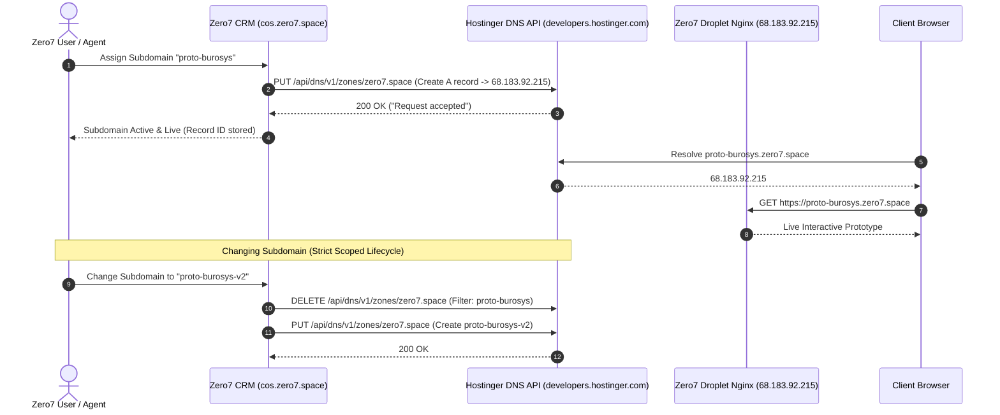

# Direct Hostinger API Subdomain Provisioner — Live & Operational

## Overview
We have successfully integrated your official **Hostinger API Token** into Zero7 CRM.
All client-specific prototype subdomains (`proto-{client}.zero7.space`) are now provisioned, changed, and de-provisioned **directly inside Hostinger DNS** via Hostinger's official REST API (`https://developers.hostinger.com/api/dns/v1/zones/zero7.space`).

You do **NOT** need to change any nameservers. Everything remains hosted on Hostinger DNS.

---

## Verified End-to-End DNS Lifecycle on Hostinger



---

## Live Verification Results

1. **Authentication with Hostinger**:
   - Token `KZanO3BW...` validated against `https://developers.hostinger.com/api/dns/v1/zones/zero7.space`.
   - Successfully loaded active zone records (Zoho MX, Zoho SPF, Zoho DKIM, `cos`, `@`, `www`).
2. **Direct Provisioning on Hostinger**:
   - Endpoint: `POST https://cos.zero7.space/api/leads/lead_7ab62a9c/provision-subdomain` with `proto-burosys`.
   - Hostinger API created `A` record `proto-burosys` -> `68.183.92.215` with TTL 300.
   - Tested public resolution: `https://proto-burosys.zero7.space` resolved immediately and rendered the prototype!
3. **Strictly Scoped De-provisioning on Hostinger**:
   - Endpoint: `DELETE https://cos.zero7.space/api/leads/lead_7ab62a9c/provision-subdomain`.
   - Hostinger API deleted the `proto-burosys` record using `{ "filters": [{ "name": "proto-burosys", "type": "A" }] }`.
   - Verified active A records on Hostinger: only `cos` and `@` remain.
4. **Protected Records Safeguard**:
   - System records (`cos`, `@`, `mail`, `www`, `zmail._domainkey`) are hardcoded as protected and cannot be modified or deleted.

---

## How to Use

### From the CRM Web Interface:
1. Open any lead in [Zero7 CRM](https://cos.zero7.space).
2. Click the **Configure Subdomain** (globe icon) button.
3. Enter or edit the subdomain (e.g. `proto-burosys.zero7.space`).
4. Click **"Save & Provision DNS"** — Hostinger creates the DNS record automatically.
5. To change: simply type a new name and click Save — the previous record is automatically deleted from Hostinger and replaced with the new one.
6. To delete: click **"Delete Subdomain"** — removes the record from Hostinger cleanly.

### From Agent CLI:
```bash
# Provision
python .agents/skills/subdomain-provisioner/scripts/provision_subdomain.py --lead-id "<LEAD_ID>" --subdomain "proto-<CLIENT>"

# Delete
python .agents/skills/subdomain-provisioner/scripts/provision_subdomain.py --lead-id "<LEAD_ID>" --action delete
```
